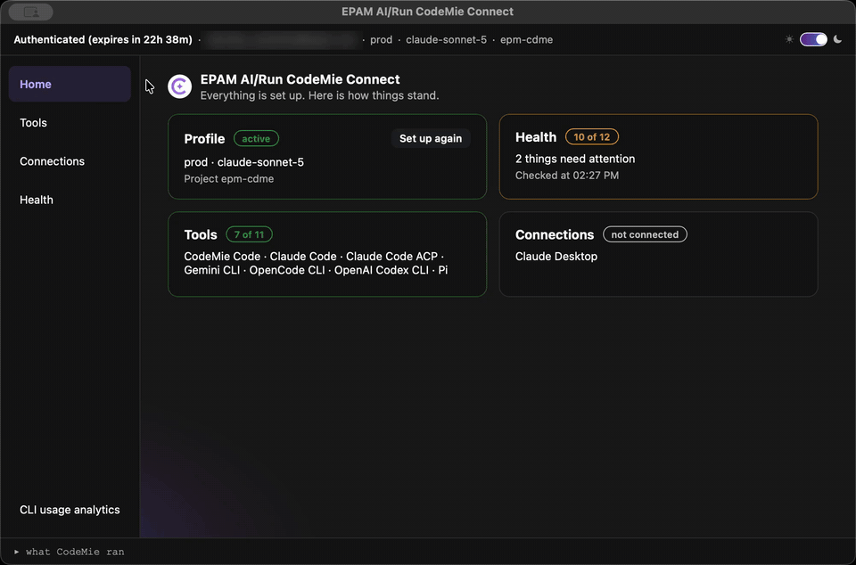

<div align="center">


# CodeMie Connect

**Set up CodeMie, your AI coding tools and Claude Desktop on a Mac in a few clicks. No terminal required.**

[](https://github.com/codemie-ai/codemie-connect/releases/latest)
[](https://github.com/codemie-ai/codemie-connect/actions/workflows/ci.yaml)
[](#requirements)
[](https://tauri.app)
[](#download)



</div>

## What is it

CodeMie Connect is a small native macOS app that gets you from a fresh Mac to a working
[CodeMie](https://github.com/codemie-ai/codemie-code) setup. It installs and configures the
CodeMie CLI, signs you in, installs AI coding tools such as Claude Code, points Claude Desktop
at the CodeMie gateway, and checks that everything is healthy.

- **Nothing to install first.** The app downloads what it needs (Node.js and the CodeMie CLI) on first launch, into its own folder.
- **Sign in with your EPAM account**, or bring your own key, or use a local model through Ollama.
- **Small.** About 4 MB, a Tauri app on the system WebKit instead of a bundled browser.
- **Transparent.** A "what CodeMie ran" panel lists every command the app executed for you.

## Download

<p>
  <a href="https://github.com/codemie-ai/codemie-connect/releases/latest">
    
  </a>
</p>

The button opens the latest release. Download the `CodeMie-Connect-<version>-aarch64.dmg` asset
(Apple Silicon). The app is signed, notarized by Apple, and checks for updates itself. The release
page has the notes and a `.sha256` checksum next to each disk image.

## Install

1. Open the downloaded `.dmg`.
2. Drag **CodeMie Connect** to **Applications**.
3. Launch it from Applications or Spotlight.

On the first launch the app prepares its runtime (a one-time download of a few tens of MB). If the
machine already has a CodeMie CLI, this step is skipped.

## Basic usage

The sidebar has four places plus an analytics shortcut.

| Screen | What it is for |
|---|---|
| **Home** | A checklist on first run, then status cards: sign-in, installed tools, connections, health. |
| **Tools** | Install, update and remove AI coding tools (Claude Code and others). Tools run from your terminal; this screen only sets them up. |
| **Connections** | **Connect Claude Desktop** to the CodeMie gateway, or **Restart** the connection if Claude Desktop lost it. |
| **Health** | Runs `codemie doctor` and checks your account, grouped and in plain language. |
| **CLI usage analytics** | Builds an HTML report of your local AI CLI usage and opens it in the browser. |

### First run in four steps

1. **Set up CodeMie.** Choose how CodeMie reaches a model: sign in with your EPAM account (opens your browser), or use your own key, or a local model with Ollama. Pick your CodeMie project when asked.
2. **Install a tool.** Open **Tools** and install Claude Code (or any other listed tool).
3. **Connect Claude Desktop** (optional). Open **Connections** and press **Connect**.
4. **Verify.** Open **Health** and run **Check everything again**. Everything should be green.

Afterwards, use your tool from a terminal as usual, for example `claude`.

## Requirements

- macOS 10.15 or newer
- Apple Silicon Mac for the current release (`aarch64`)
- Internet access on the first launch
- A CodeMie account, or an API key for your own provider

## Troubleshooting

| Symptom | What to do |
|---|---|
| "Could not reach CodeMie" during setup | Check VPN and network, then press **Try again**. |
| Sign-in expired | Open **Home** or **Health**; the sign-in card offers to sign in again. |
| Claude Desktop lost the connection | **Connections**, then **Restart**. |
| Something fails and you need details | Expand **what CodeMie ran** at the bottom of the window, or use **Open Log** in the setup view. |

## Development

```bash
# tests
npm test                          # frontend unit tests (node:test)
cargo test --manifest-path src-tauri/Cargo.toml

# run the app with hot reload
cd src-tauri && cargo tauri dev
```

Prerequisites: stable [Rust](https://rustup.rs), the Tauri CLI (`cargo install tauri-cli --version "^2" --locked`) and Node.js.

How it is built: the install logic lives in the frontend as plain ES modules (`ui/`), and the
Rust backend (`src-tauri/`) only exposes system operations (running commands, PTY, downloads,
PATH handling) as Tauri commands. See [AGENTS.md](AGENTS.md) and `.ai-run/guides/` for the
architecture and conventions.

## Releasing

Bump the version in `src-tauri/tauri.conf.json` and `src-tauri/Cargo.toml`, merge to `main`, then push a
matching tag:

```bash
git tag v2.1.1 && git push origin v2.1.1
```

The release workflow builds, signs and notarizes the DMG and publishes it with a checksum.

---

<div align="center">
EPAM AI/Run CodeMie
</div>
