# Workspace next · verification report

Branch `feat/workspace-next` → `workspace-app` · release build 2.1.1 · 27 Nov 2026

**Verdict:** all ten rollout steps are built and verified. 142 planned behaviours: 124 shown in the real app by the tour, 18 checked in the browser run (actions the tour refuses on purpose: sends, folder pickers, live AI), 0 missing. Screenshots below come from the browser run and use synthetic test data only.

## Gates

| Check | Result |
|---|---|
| fmt + clippy `-D warnings` | clean |
| `npm test` | 1473 pass · 0 fail |
| `cargo test` | 1253 pass · 0 fail |
| Contract fixtures | regenerated, no drift |
| Whole browser run (both themes, both views, 1000/1440/1680) | 796/796, then reply 58/58, ask 40/40, compact 30/30, layout 31/31, tasks-provider 41/41 |
| `make tour` on `1b21c63` | 83/83 stops |
| Marketplace plugin tests (Todoist, Knowledge) | 136/136 |
| Real Todoist/Knowledge plugins in Connect's host | 15/15 |
| Status + plugin smokes, privacy greps | pass · no question/answer/voice text or real addresses |
| Live Todoist with a real token | needs_token → ready, syncs succeed |
| Release app launched on real data (desktop pass, no sends) | Inbox open-in-place, ✦ draft, ⌘K Ask, Meetings, Today inline reply, Settings |

## Coverage by step

| Step | What | Real app | Browser run | Missing |
|---|---|---:|---:|---:|
| 0 | Connect marketplace | 4 | 0 | 0 |
| 1 | Compact view | 10 | 0 | 0 |
| 2 | Reply | 14 | 3 | 0 |
| 3 | Meetings default view | 16 | 0 | 0 |
| 4 | Task provider + Todoist | 19 | 1 | 0 |
| 5 | Create-tasks delivery + templates | 9 | 0 | 0 |
| 6 | Menu-bar count | 4 | 2 | 0 |
| 7 | Profiles and models | 12 | 1 | 0 |
| 8 | Reply in your voice | 20 | 6 | 0 |
| 9 | Ask ⌘K + quick capture ⌘N | 16 | 5 | 0 |

Added on request after the plan: inline reply on Today's "Needs your reply" (both views; the reply box stays in view in a short widget), and Todoist listing tasks from all projects (plugin 1.1.0, in the marketplace repo).

## Evidence
### Step 0 · Connect marketplace
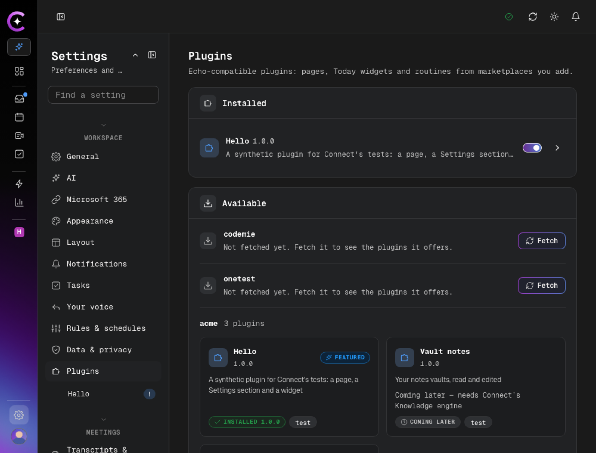
*Settings › Plugins with the codemie marketplace*

### Step 1 · Compact view
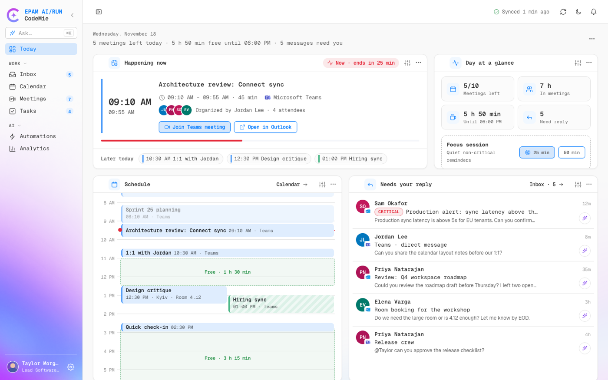
*Compact Today*

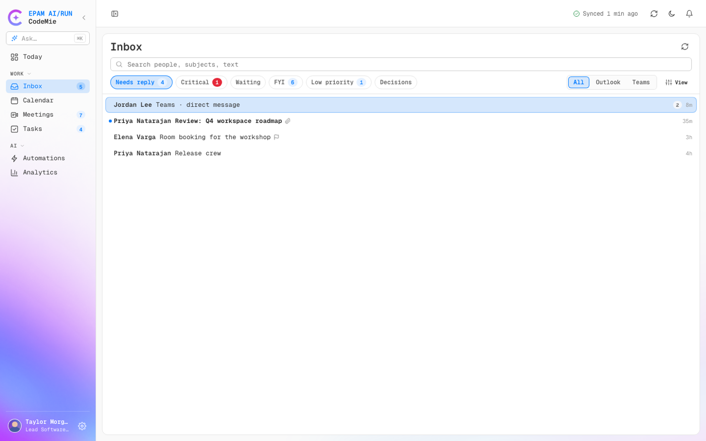
*Compact Inbox*

### Step 2 · Reply
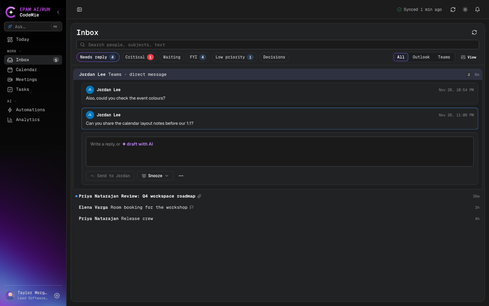
*Reply: ✦ draft link and one named Send*

### Step 3 · Meetings default view
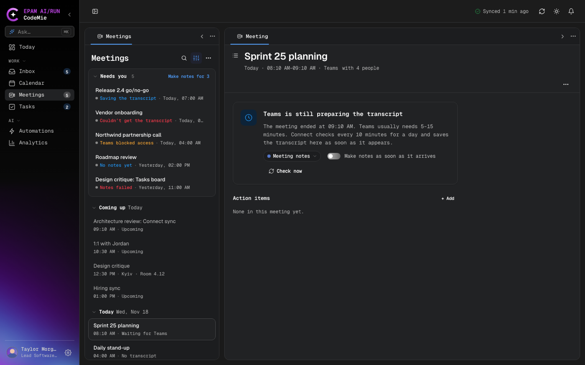
*Meeting: summary first, action items column*

### Step 4 · Task provider + Todoist
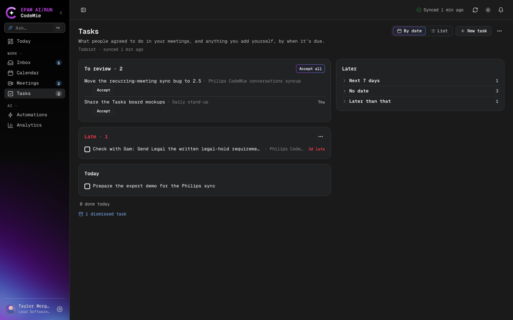
*Tasks By date with the Todoist provider*

### Step 5 · Create-tasks delivery + templates
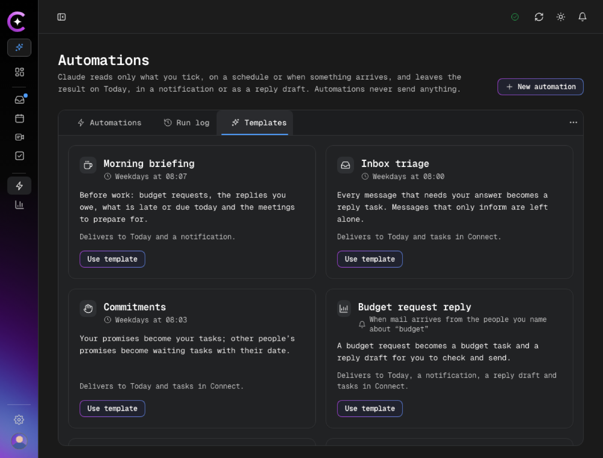
*Automation templates*

### Step 6 · Menu-bar count
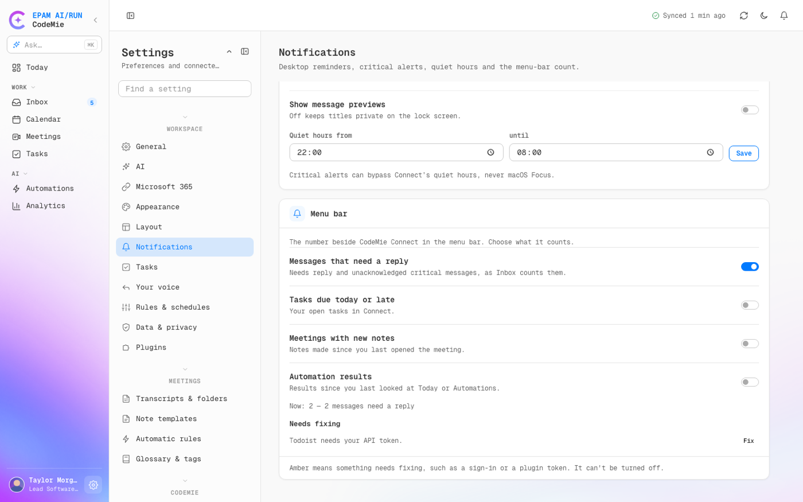
*Menu-bar count, amber when something needs fixing*

### Step 7 · Profiles and models
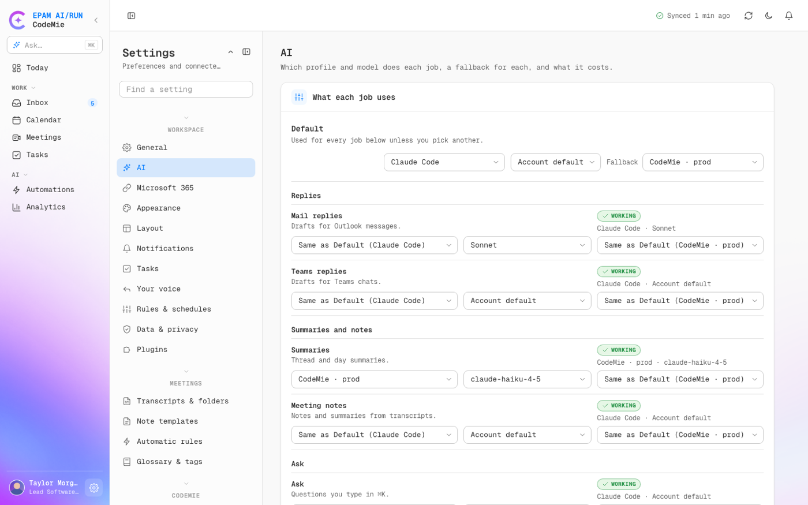
*Settings › AI: routes, fallbacks, live Test*

### Step 8 · Reply in your voice
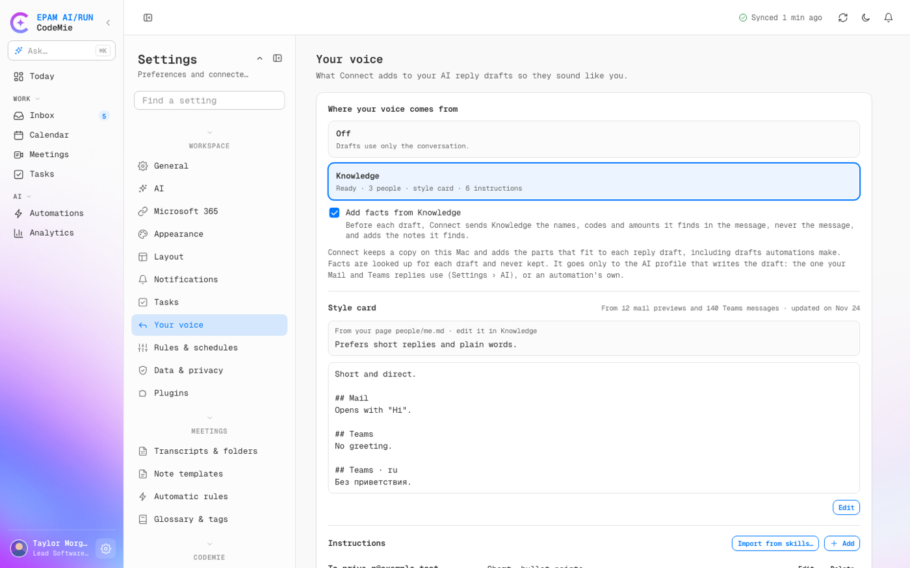
*Settings › Your voice*

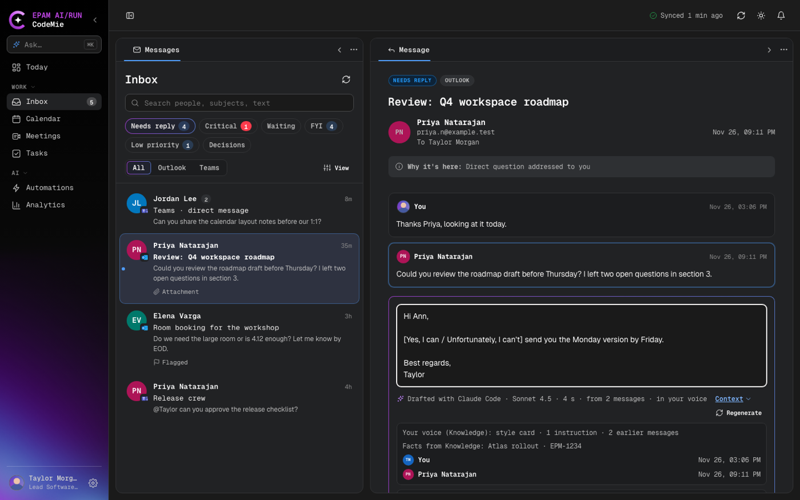
*A draft in your voice with Context*

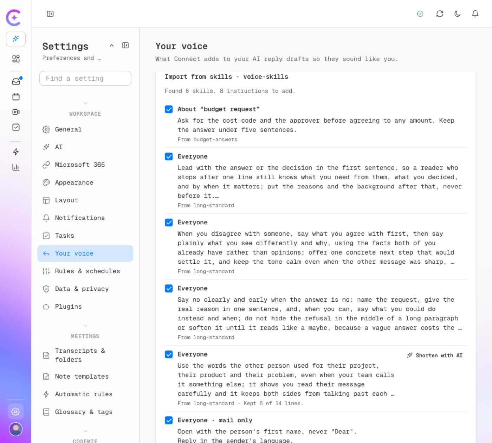
*Import from skills preview*

### Step 9 · Ask ⌘K + quick capture ⌘N
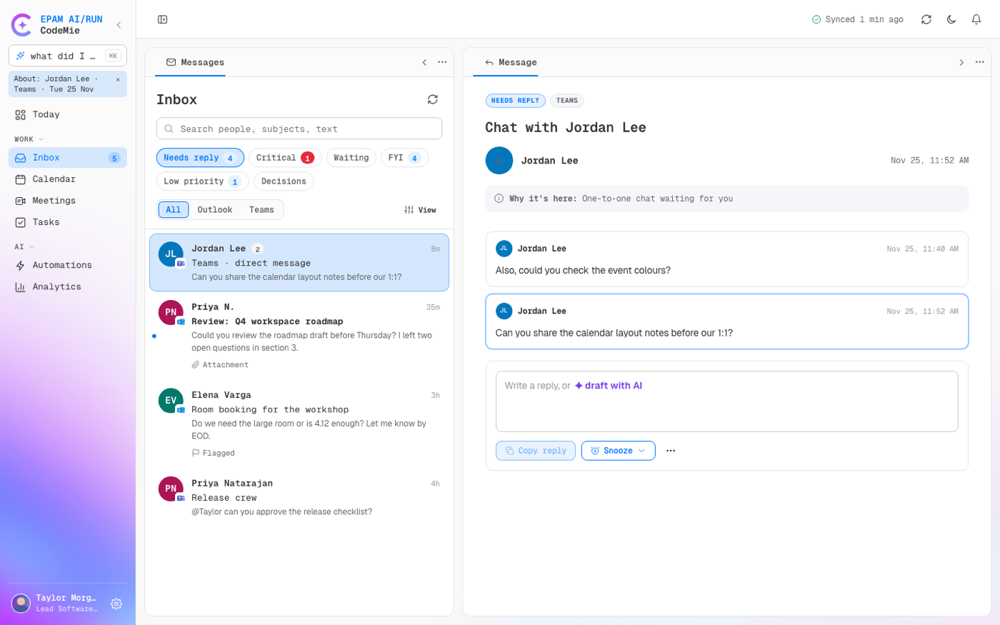
*⌘K Ask field with the About chip*

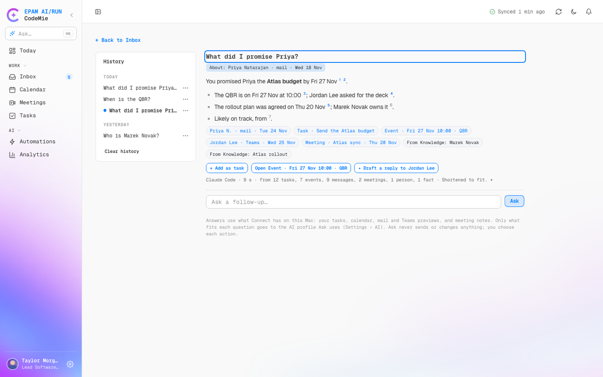
*Ask answer with cites and actions*

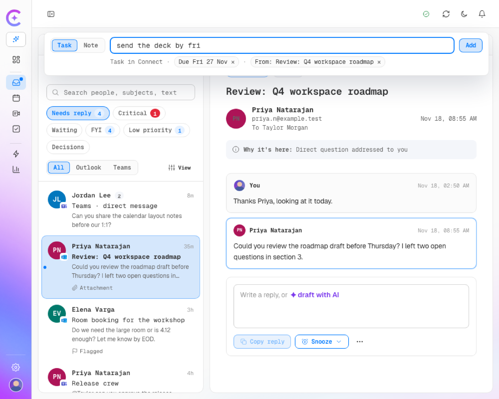
*⌘N quick capture*

## Known issues and follow-ups

- A CodeMie profile that doesn't answer makes every run routed to it time out; Settings › AI's Test shows it. Route jobs to a working profile.
- An Ollama model can return output a meeting template can't use; the meeting shows Try again.
- Deleting the voice copy doesn't clear Ask history (answers expire after 30 days).
- Todoist 1.1.0 and Knowledge 1.0.0 need publishing to `codemie-ai/codemie-connect-marketplace`.
- Deferred minors from each step's review are in its ledger under `.superpowers/sdd/archive/` (git-ignored).
